# 地方集落と街道の監査

監査前の作業版では、未解放地点を一律に空賊と判定していたため、新規の都市・町144地点がすべて攻略対象に入っていた。小型村の建物は拠点台帳から独立していたが、村単位のIDはなく、692区画から村の数は数えられなかった。

| 区分 | 監査前 | 監査後 |
|---|---:|---:|
| 大型駅前都市 | 77 | 77 |
| 中型町 | 81 | 24 |
| 本拠地・航空基地・空母 | 1・24・8 | 1・24・8 |
| 着陸可能地点 | 191 | 134 |
| 空賊解放対象 | 190 | 46 |
| 景観専用村落 | 村IDなし | 361 |
| 景観の512m区画 | 692 | 1,141 |

既存の町村14、基地24、空母8を解放対象とし、新設の民間拠点は初めから利用できる。駅前都市を全駅に残し、既存の都市圏から1.15km以上離れ、ほかの新規街道町とも4.2km以上離せる候補から地方拠点20か所を採用した。各候補の地形・滑走路は前段の測量で選定済み。残り57地点は景観用に移し、さらに外縁に304村を配置した。

## 街道と飛行画面

駅前、市街地入口、中型町、村の順に土道を細くする。直通または緩いカーブで接続できない場合は、主街道の経路を地形グリッド上で探索する。道路の両縁で地形勾配、水面、既存市街地、線路、滑走路、遺構との干渉を検査する。線路との平面交差は色と材質の異なる踏切面で描画する。河川は迂回する。採用した地形と固定シードからオフラインで区画を生成し、ゲームでは飛行位置周辺だけを復号する。

36,967枚の道路面と3,989件の住宅・作業施設・農地区画を収録した。道路端点の量子化誤差を許容してグラフを作り、各村から所属駅の駅前260m圏または大型都市入口210m圏までの連結を確認した。これらは飛行景観上の接続判定である。

北原の農地や風車、林業地域の丸太、工業地域の工房、沿岸の網干し場を地域ごとに使い分ける。中高度では土道と畑を目印に集落を追え、低空では屋根や柵、作業設備が見える。画面は同一座標・方位で地上55mと170mから撮影した。

| 地点 | 地上55m | 地上170m |
|---|---|---|
| 駅前都市 | [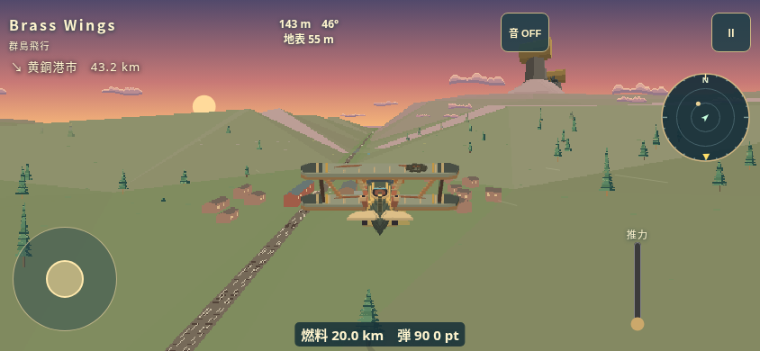](station-55.png) | [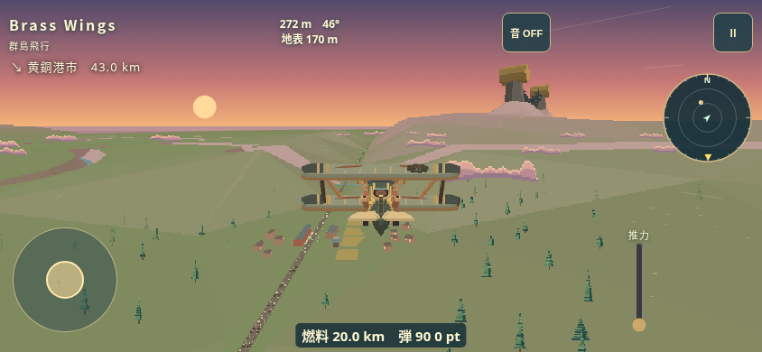](station-170.png) |
| 駅前都市から街道町へ | [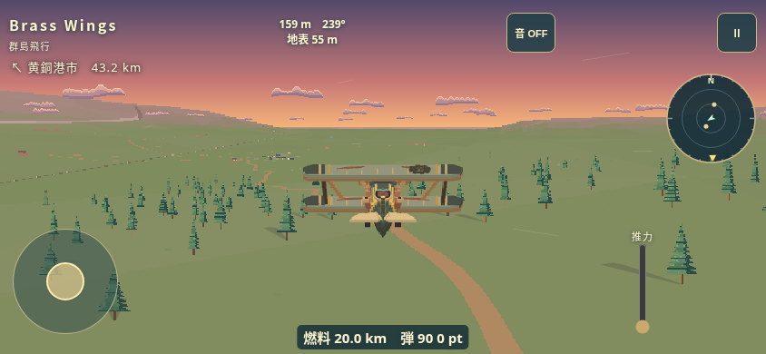](city-town-55.png) | [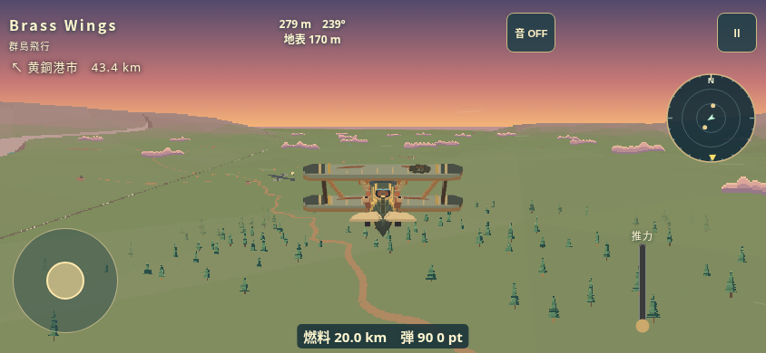](city-town-170.png) |
| 町から小型村へ | [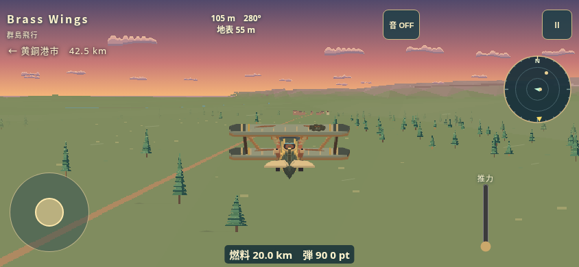](town-village-55.png) | [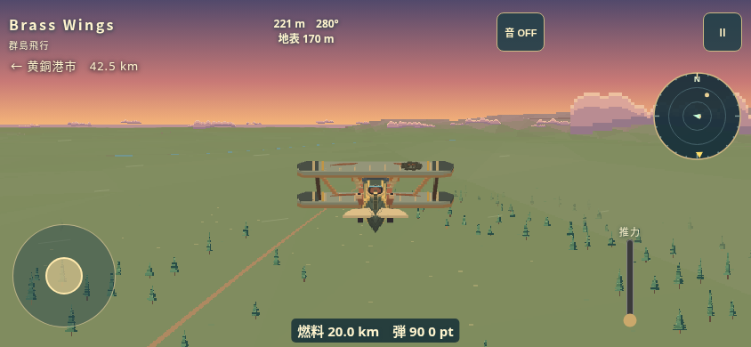](town-village-170.png) |
| 農地と住宅 | [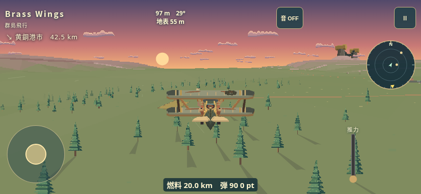](farmland-55.png) | [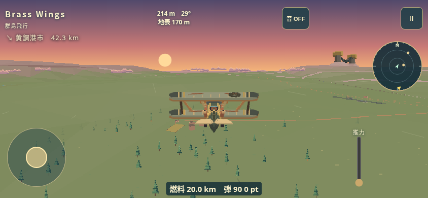](farmland-170.png) |
| 駅から離れた地方 | [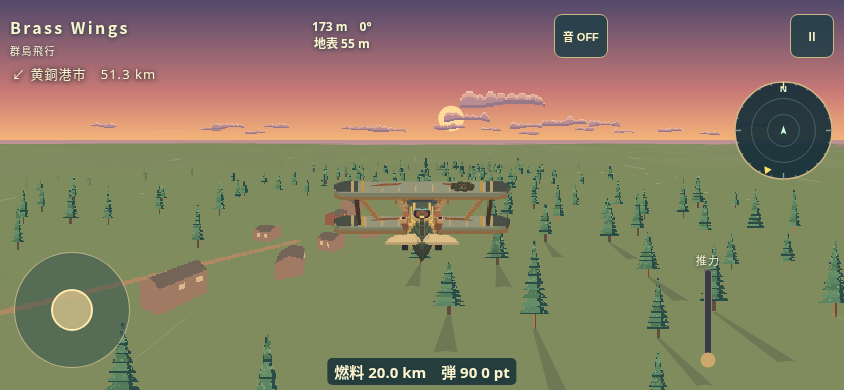](remote-55.png) | [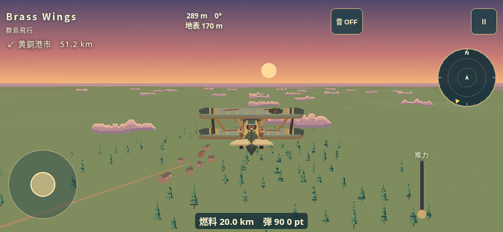](remote-170.png) |
| 沿岸集落 | [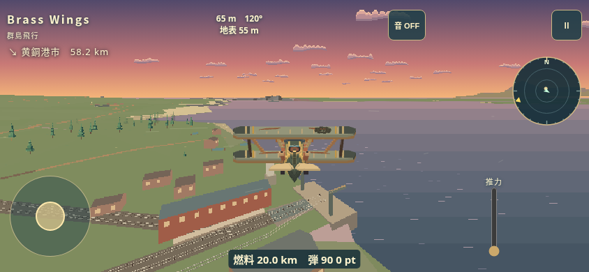](coast-55.png) | [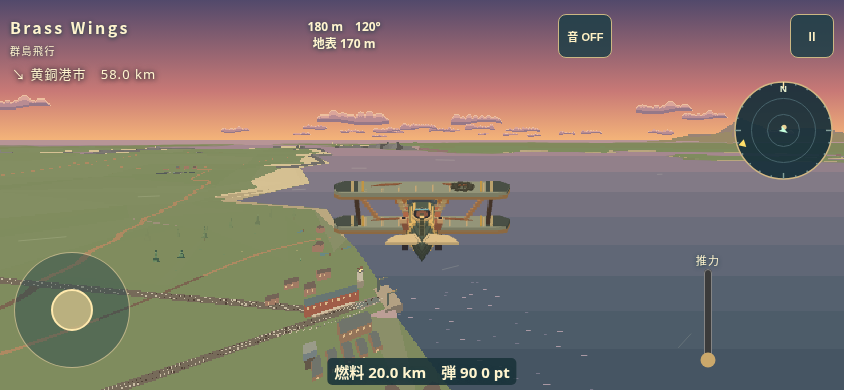](coast-170.png) |

## 地図・経済・記録

地図の行き先を地方別にまとめ、発見済みの拠点と主要な探訪地点を表示する。着陸可能な都市・町101地点が交易・輸送の対象となる。掲示板は現地で必要になった際に10〜30kmの候補から最大5件を生成する。景観村は対象外。ファストトラベルは現地登録10件までで、輸送依頼中は利用できない。500G開始、地域別補給、数量購入、実飛行距離に基づく利益保証を維持した。

v5では旧飛行場の停機地点・登録先を安全な民間または解放済みの拠点へ移す。同じ生活圏を優先する。進行中の輸送は依頼IDと積荷を引き継ぎ、距離帯内の納品先に振り直す。受注前の旧掲示板は無効な行き先を含む場合に再生成する。旧飛行場で仕入れたロットは、元の仕入れ地と座標・価格・飛行距離を保持する。旧版での訪問と解放の履歴を保存し、民間拠点の履歴は46拠点の達成率から除く。

## 描画計測

Chromium 156.0.8078.79 のタッチ端末エミュレーション。小麦台駅の南500mから北へ毎フレーム24mずつ、地上125mを5.76km移動した。同じ区間を3回繰り返し、各回の先頭24フレームを除いた。表は3回の中央値。ヒープは各回のGC後のJavaScript使用量。端末の物理メモリやGPU全体の使用量とは別の測定値である。

| ビルド | 画面 | 平均FPS | フレーム時間p95 (ms) | 保持ヒープ (MiB) |
|---|---|---:|---:|---:|
| 追加前 main | 横844×390 | 55.6 | 33.3 | 12.8 |
| 追加前 main | 縦390×844 | 57.9 | 16.8 | 12.9 |
| 監査前 de2ea67 | 横844×390 | 54.9 | 33.3 | 13.9 |
| 監査前 de2ea67 | 縦390×844 | 57.9 | 16.8 | 14.1 |
| 監査後 | 横844×390 | 55.9 | 33.3 | 14.5 |
| 監査後 | 縦390×844 | 58.9 | 16.8 | 13.5 |

全77駅を3周する別試験では展開区画が最大85区画、各周で観測した保持区画数の合計はすべて2,729だった。総数1,141区画のうち、飛行位置から離れた区画が解放されることを確認した。短い定点航路の計測であり、実機iOS・Android、Safari、長時間の実機発熱・消費電力は未検証。[測定ログと撮影座標](results.json)

全77駅と生活圏の対応

| 駅 | 大型都市 | 中型町 | 景観村数 |
|---|---|---|---:|
| 西域貨物 | 西域貨物駅前市 | — | 5 |
| 西原穀倉 | 西原穀倉駅前市 | — | 5 |
| 樫林製材所 | 樫林製材所駅前市 | 黄銅港市 | 5 |
| 西関煉瓦工場 | 西関煉瓦工場駅前市 | — | 5 |
| 黄銅港中央 | 黄銅港中央駅前市 | — | 5 |
| 港北集荷場 | 港北集荷場駅前市 | — | 5 |
| 東野 | 東野駅前市 | — | 5 |
| 黄銅埠頭 | 黄銅埠頭駅前市 | — | 4 |
| 紫煙中央 | 紫煙中央駅前市 | 赤棚鉱山市 | 5 |
| 西麓林場 | 西麓林場駅前市 | — | 5 |
| 南谷鋳造所 | 南谷鋳造所駅前市 | — | 5 |
| 東麓積替場 | 東麓積替場駅前市 | — | 5 |
| 赤棚鉱山 | 赤棚鉱山駅前市 | — | 5 |
| 紫煙南工場 | 紫煙南工場駅前市 | — | 5 |
| 南原市場 | 南原市場駅前市 | — | 5 |
| 河岸製材所 | 河岸製材所駅前市 | — | 5 |
| 紫煙河口 | 紫煙河口駅前市 | 紫煙河口街道町 | 4 |
| 赤銅中央 | 赤銅中央駅前市 | 赤銅要塞群島 | 5 |
| 要塞兵站庫 | 要塞兵站庫駅前市 | — | 5 |
| 赤銅埠頭 | 赤銅埠頭駅前市 | — | 5 |
| 南谷分岐 | 南谷分岐駅前市 | — | 5 |
| 谷口製材場 | 谷口製材場駅前市 | — | 5 |
| 河谷織布場 | 河谷織布場駅前市 | — | 4 |
| 上谷集荷場 | 上谷集荷場駅前市 | — | 5 |
| 白嶺峠口 | 白嶺峠口駅前市 | — | 5 |
| 西原畜産市 | 西原畜産市駅前市 | — | 5 |
| 泥炭積場 | 泥炭積場駅前市 | — | 5 |
| 松林南伐区 | 松林南伐区駅前市 | — | 5 |
| 松林材木廠 | 松林材木廠駅前市 | — | 5 |
| 樹液精製所 | 樹液精製所駅前市 | — | 5 |
| 西堤穀物市 | 西堤穀物市駅前市 | — | 5 |
| 鋳型煉瓦窯 | 鋳型煉瓦窯駅前市 | — | 5 |
| 西都鋳造廠 | 西都鋳造廠 | 西都鋳造廠街道町 | 4 |
| 西都汽罐廠 | 西都汽罐廠駅前市 | — | 5 |
| 小麦台 | 小麦台駅前市 | 小麦台街道町 | 4 |
| 風車村 | 風車村 | 風車村街道町 | 4 |
| 北穀倉 | 北穀倉駅前市 | — | 5 |
| 鋳物師町 | 鋳物師町 | — | 5 |
| 樫木場 | 樫木場駅前市 | — | 5 |
| 波止場倉庫前 | 波止場倉庫前駅前市 | — | 5 |
| 琥珀湾 | 琥珀湾駅前市 | 琥珀湾街道町 | 4 |
| 北原粉挽村 | 北原粉挽村 | 北原粉挽村街道町 | 4 |
| 樽板製材所 | 樽板製材所駅前市 | — | 5 |
| 入江集荷場 | 入江集荷場駅前市 | 入江集荷場街道町 | 4 |
| 北入江 | 北入江駅前市 | 北入江街道町 | 4 |
| 高地牧場 | 高地牧場駅前市 | 紫煙の屈曲谷 | 5 |
| 北斜面伐木場 | 北斜面伐木場駅前市 | 北斜面伐木場街道町 | 4 |
| 灰石採石場 | 灰石採石場駅前市 | — | 5 |
| 北峡湾 | 北峡湾駅前市 | — | 4 |
| 赤棚選鉱場 | 赤棚選鉱場駅前市 | — | 5 |
| 鉱炉前 | 鉱炉前駅前市 | — | 5 |
| 東麓木材市 | 東麓木材市駅前市 | — | 5 |
| 紫煙東麓 | 紫煙東麓駅前市 | — | 5 |
| 河口積替場 | 河口積替場駅前市 | — | 4 |
| 板石採掘場 | 板石採掘場駅前市 | — | 5 |
| 黒松製材所 | 黒松製材所駅前市 | — | 5 |
| 粘板岩港 | 粘板岩港駅前市 | — | 5 |
| 要塞鋳物町 | 要塞鋳物町 | 要塞鋳物町街道町 | 4 |
| 南岸薪炭林 | 南岸薪炭林駅前市 | — | 5 |
| 石炭積替場 | 石炭積替場駅前市 | 石炭積替場街道町 | 4 |
| 炭積港 | 炭積港駅前市 | — | 5 |
| 炭焼村 | 炭焼村 | 炭焼村街道町 | 4 |
| 銅鉱選別所 | 銅鉱選別所駅前市 | 銅鉱選別所街道町 | 4 |
| 南都精錬町 | 南都精錬町 | — | 5 |
| 南銅都 | 南銅都 | 南銅都街道町 | 4 |
| 銅都機械工場 | 銅都機械工場駅前市 | — | 5 |
| 麦俵市場 | 麦俵市場駅前市 | 麦俵市場街道町 | 4 |
| 南原穀物庫 | 南原穀物庫駅前市 | — | 5 |
| 南穀倉 | 南穀倉駅前市 | 南穀倉街道町 | 4 |
| 南都煉瓦工場 | 南都煉瓦工場駅前市 | 南都煉瓦工場街道町 | 4 |
| 登窯集落 | 登窯集落 | — | 5 |
| 白土採掘場 | 白土採掘場駅前市 | 白土採掘場街道町 | 4 |
| 陶土丘 | 陶土丘駅前市 | — | 5 |
| 東岸網元村 | 東岸網元村 | 東岸網元村街道町 | 4 |
| 造船材集荷場 | 造船材集荷場駅前市 | — | 5 |
| 岬守補給所 | 岬守補給所駅前市 | — | 5 |
| 赤岬前哨地 | 赤岬前哨地駅前市 | 赤岬前哨地街道町 | 4 |

## 再現

`node tools/country/bake.cjs` で配置を焼き直し、`node scripts/build.js` で配布用単体HTMLを生成する。`node tools/country/verify.cjs` は区画内の所属と端点、`node tests/country-terrain.cjs` は飛行地形・道路網・キャッシュ、`node tests/settlement-registry.cjs` は拠点分類と旧セーブ復元を検証する。`node docs/country-audit/audit.cjs` で画面と計測ログを更新できる。
