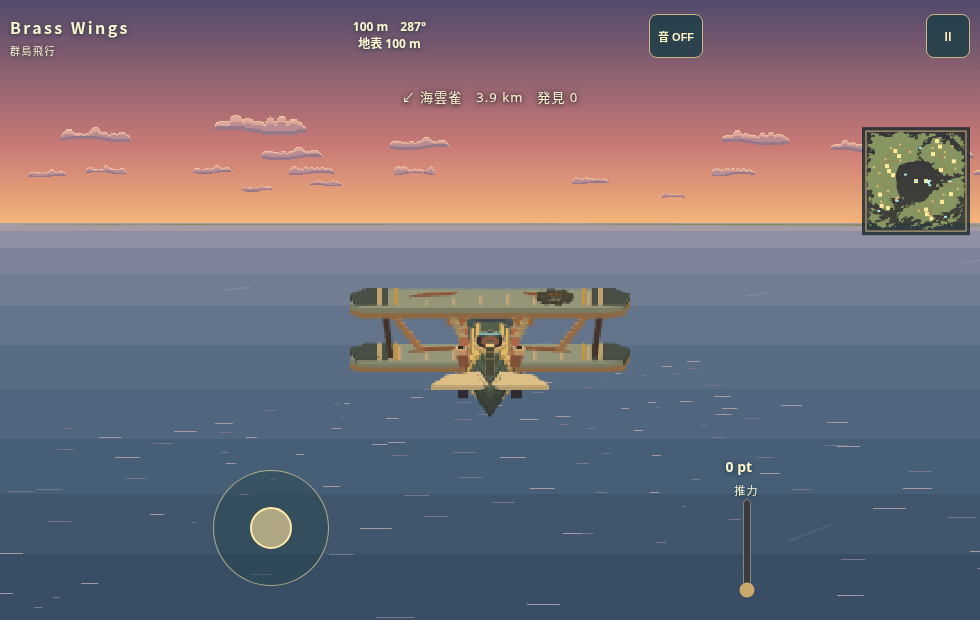
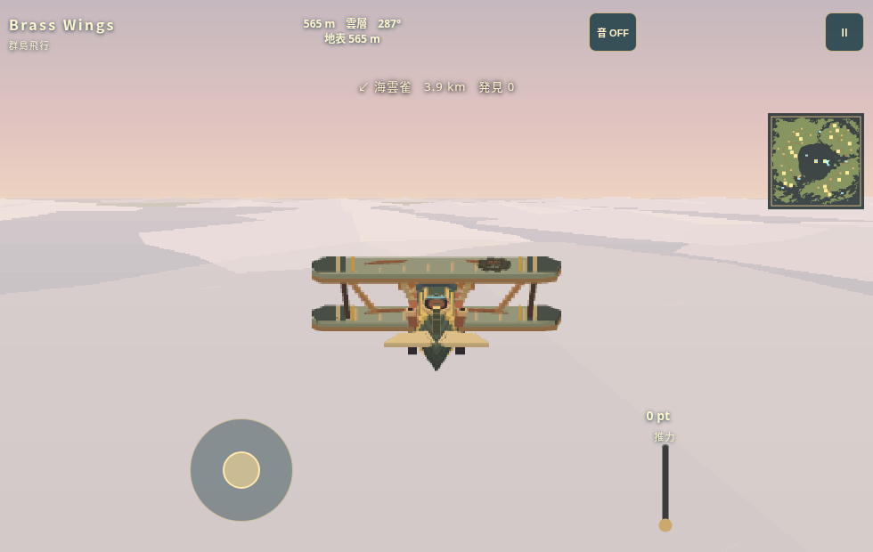
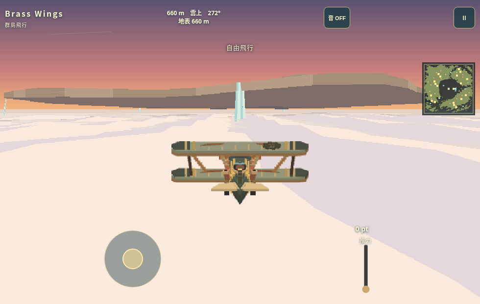
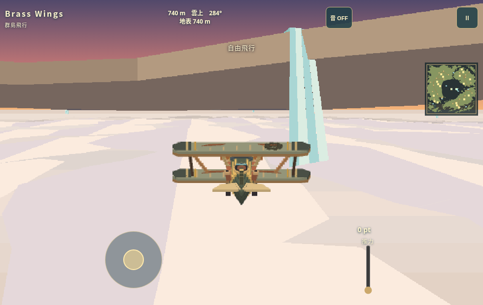
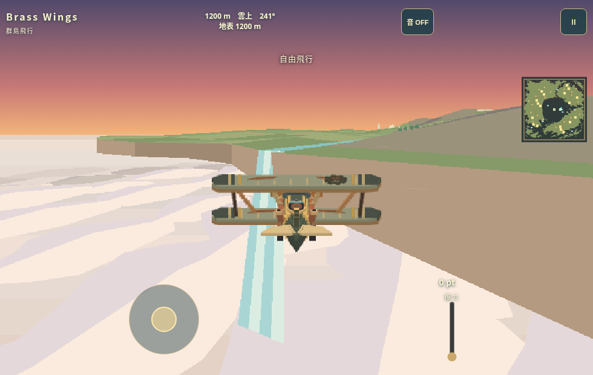
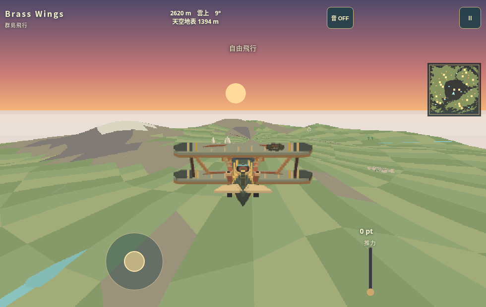
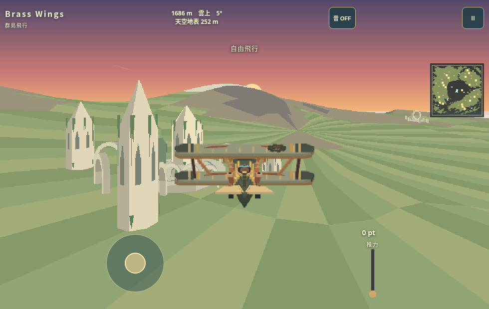
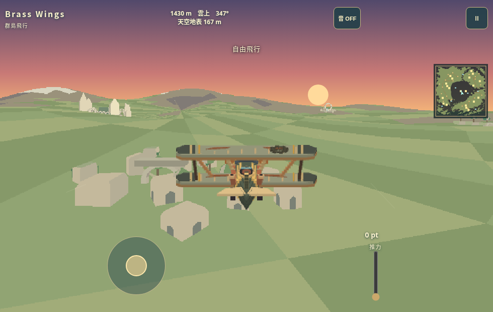
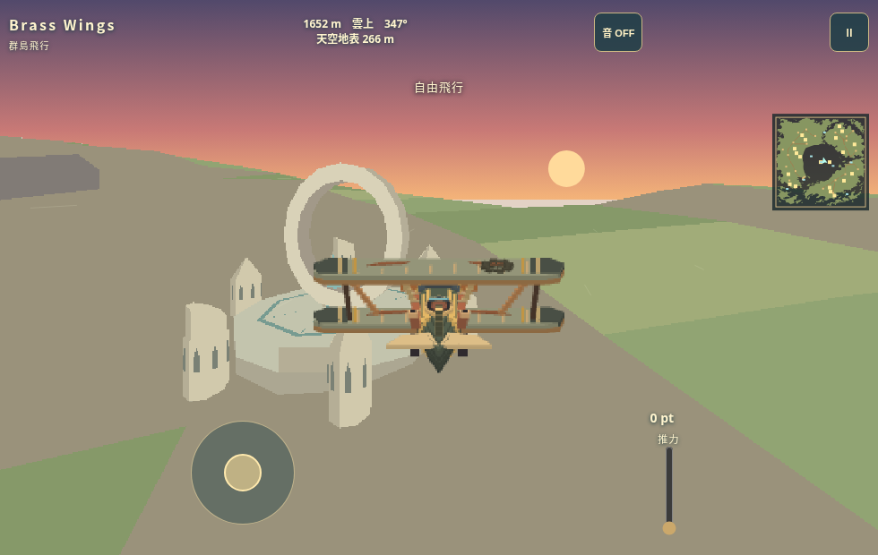
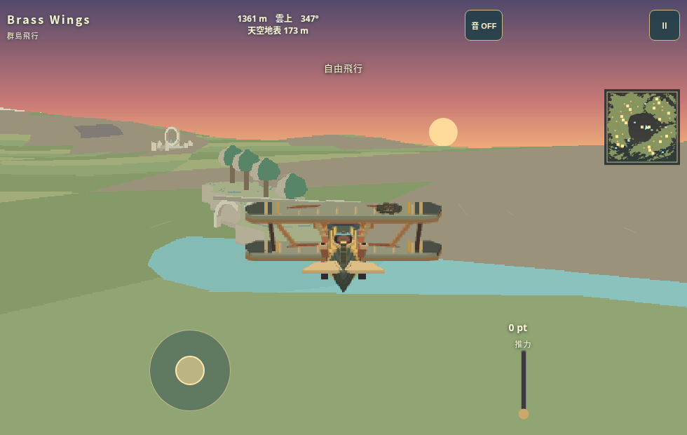

# 天蓋浮遊大陸の飛行記録

中央大海の (50, 50) km を中心とする基本半径10 kmの天空大陸。外側から雲を抜け、崖に沿って上昇すると、滝の水源から庭園・王都へ飛べる。上面の頂点標高は1,115～2,246 m。地上基準の上昇上限3,200 mは、中央大海で最高峰より約954 mの余裕を持つ。

| 中央大海 | 雲層内 | 突破直後 |
|---|---|---|
|  |  |  |

| 岩盤下面 | 外縁と滝 | 山脈上空 |
|---|---|---|
|  |  |  |

| 地区（X, Z、km） | Chromiumでの飛行視点 |
|---|---|
| 王都・冠の広場 (49, 49)。中央広場から宮殿跡と蔦の回廊を望む。 |  |
| 南門の集落 (52.3, 46.4)。もう一つの集落は (45.4, 50.9)。 |  |
| 星環の観測院 (53.6, 52.1)。環状石造物、結晶と術式の祭壇。 |  |
| 水鏡の空中庭園 (56, 50)。段状の庭園、水路と石橋。 |  |

[庭園の縦画面](garden-390.png) ／ [横画面](garden-844.png)

## 描画と接触

中心から27 km以内、高度610 m以上で天空に進入する。高度550 m未満、または距離28.5 km以上で地上描画に戻る。境界では約0.56秒の雲のフェードを使う。上面と下面は地上の高度照会とは独立した三角形補間。地上区画の描画準備を停止しても地上衝突は同期照会できる。

天空地形は64扇区を4区ずつ束ね、距離に応じて半径方向のサンプル間隔を切り替える。遺跡は15.5 kmで解放し、6.5 km・2.6 km・1.25 kmを境に建築の輪郭、装飾、窓と蔦を切り替える。地形・遺跡の静的GPUバッファには合計1.5 MiBの上限がある。地上復帰時は区画GPUアップロードを当初1フレーム3件までとし、植生の展開範囲を広げる。

## 計測

同一のChromium、980×620、固定カメラ。10フレームの準備後に32フレーム計測。改修前はPR #16マージ済みの main。地上は (22, 40) km、高度100 m。天空は (49.2, 47.92) km、高度1,800 m。FPSは実行環境の負荷によって変動する。

| 地点・版 | FPS | 描画呼び出し/フレーム | 三角形/フレーム | CPU地形 B | 地形GPU B | 鉄道GPU B | 天空静的GPU B |
|---|---:|---:|---:|---:|---:|---:|---:|
| 地上・前 | 46.8 | 33 | 9,578 | 48,669 | 95,712 | 255,360 | 0 |
| 地上・後 | 53.3 | 33 | 9,308 | 48,669 | 95,712 | 255,360 | 0 |
| 天空・前 | 58.2 | 3 | 5,038 | 0 | 0 | 0 | 0 |
| 天空・後 | 56.5 | 24 | 12,024 | 0 | 0 | 0 | 648,480 |

旧版は浮遊大陸を動的バッファで送っていた。表のキャッシュ量は用途別に追跡できる値で、ブラウザー全体のメモリ使用量は含まない。地上区画が存在する (27, 56) kmでも20往復し、上昇後の地形・鉄道GPUと下降後の天空GPUが毎回0バイトになることを確認した。

```sh
node scripts/build.js
CHROMIUM_PATH=/usr/bin/chromium SKY_SCREENSHOTS=/tmp/sky-kingdom node tests/sky-kingdom.cjs
```

旧版HTMLとの比較は環境変数 `SKY_BASELINE` にその絶対パスを指定する。新規試験は外部通信を遮断し、既存20件の初回発見日時、最高峰横断、急降下・下面・崖・各地区の接触、旋回中の地上ストリーミング停止を検査する。iOS・Android実機、Safari、長時間の連続飛行は未検証。
